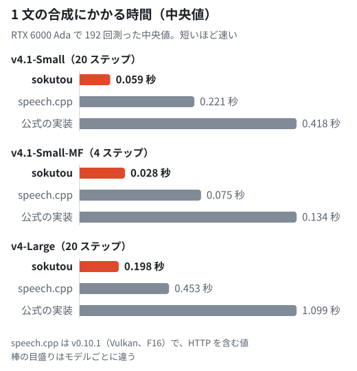

<p align="center"></p>

<h1 align="center">sokutou</h1>

<p align="center">
  Irodori-TTS（v4.1-Small、v4.1-Small-MF、v4-Large）、Qwen3-TTS（12Hz の 0.6B・1.7B CustomVoice）、Fish Audio Drama 3 を NVIDIA の GPU で速く動かす音声合成サーバー
</p>

<p align="center">
  <a href="#モデル">モデル</a> ·
  <a href="#精度と速度">精度と速度</a> ·
  <a href="#動かし方">動かし方</a> ·
  <a href="#api">API</a> ·
  <a href="#qwen3-tts">Qwen3-TTS</a> ·
  <a href="#fish-audio-drama-3">Drama 3</a> ·
  <a href="docs/results.md">結果の詳細</a>
</p>

sokutou は [Irodori-TTS](https://github.com/Aratako/Irodori-TTS)、[Qwen3-TTS](https://github.com/Qwen/Qwen3-TTS)、[Fish Audio Drama 3](https://huggingface.co/fishaudio/drama-3) の推論を NVIDIA の GPU で速くしたエンジンと、それを差し込んだ音声合成サーバーです。どのサーバーも OpenAI の音声 API と同じ形の `POST /v1/audio/speech` で WAV を返します。Irodori-TTS は参照音声の声で話し、Qwen3-TTS は決まった 9 人の話者から選んで話します。Drama 3 は参照音声とその書き起こしを渡すとその声で話し、渡さないと文ごとにモデルが声を選びます。Built with Fish Audio.

> sokutou runs Irodori-TTS (v4.1-Small, v4.1-Small-MF and v4-Large), Qwen3-TTS 12Hz CustomVoice (0.6B and 1.7B) and Fish Audio Drama 3 faster on NVIDIA GPUs, served over an OpenAI-style `POST /v1/audio/speech`. On one RTX 6000 Ada every model synthesizes a sentence faster than speech.cpp v0.10.1 and the official implementation; Irodori-TTS v4.1-Small at 20 steps takes a median 0.053 s, against 0.221 s for speech.cpp and 0.419 s for the official PyTorch implementation. Drama 3 is Built with Fish Audio. This README is in Japanese.

**同じ GPU で、どのモデルも speech.cpp と公式の実装より速く合成します。** RTX 6000 Ada で 1 文の合成にかかる時間の中央値は、Irodori-TTS v4.1-Small（20 ステップ）で 0.053 秒です。speech.cpp v0.10.1 は 0.221 秒、公式の実装は 0.419 秒でした。モデルごとの値は「[精度と速度](#精度と速度)」にあります。

**Irodori-TTS では、重みと API は公式の実装のままです。** 読み込むのは Hugging Face にある公式の重みです。API、入力の確認、24kHz への変換、無音の切り落としは、公式の実装で合成するサーバー（`server/server.py`）と同じコードを使います。Qwen3-TTS と Drama 3 のサーバーも同じエンドポイントとヘッダーで答えます（受け付ける項目は、[Qwen3-TTS](docs/models/qwen3-tts.md#api-と環境変数) と [Drama 3](docs/models/drama3.md#api-と環境変数) のページにあります）。

**公式の実装と数値で突き合わせています。** どのモデルも公式の実装と同じ入力から途中の値と出力を比べて確かめています。

**公開されているものだけで作れます。** Dockerfile は Docker Hub の python のイメージから始め、版を固定した Irodori-TTS を GitHub から、依存を PyPI と PyTorch の配布元（download.pytorch.org）から取得します。Qwen3-TTS のイメージも、python のイメージ、PyPI、PyTorch の配布元だけから作ります。Drama 3 のイメージは、これに GitHub の fish-speech を加えて作ります。

<picture>
  <source media="(prefers-color-scheme: dark)" srcset="assets/speed-dark.svg">
  
</picture>

## モデル

| モデル | 声 | sokutou の重みの型 | 中身 |
| --- | --- | --- | --- |
| [Irodori-TTS v4.1-Small](https://huggingface.co/Aratako/Irodori-TTS-v4.1-Small) | 参照音声の声 | BF16 | 既定のモデルです |
| [Irodori-TTS v4.1-Small-MF](https://huggingface.co/Aratako/Irodori-TTS-v4.1-Small-MF)（以下、MF 版） | 参照音声の声 | BF16 | v4.1-Small を MeanFlow で蒸留したモデルです。4 ステップで合成し、CFG がありません |
| [Irodori-TTS v4-Large](https://huggingface.co/Aratako/Irodori-TTS-v4-Large) | 参照音声の声 | BF16 | 約 3.3B のパラメーターを持つモデルです。文と caption のエンコーダーは T5Gemma 2 から作られています |
| [Qwen3-TTS 12Hz 0.6B CustomVoice](https://huggingface.co/Qwen/Qwen3-TTS-12Hz-0.6B-CustomVoice)、[1.7B CustomVoice](https://huggingface.co/Qwen/Qwen3-TTS-12Hz-1.7B-CustomVoice) | 決まった 9 人の話者 | int8（bf16 も選べます） | 言語モデルが音声のコードを 1 フレーム（0.08 秒）ずつ作ります |
| [Fish Audio Drama 3](https://huggingface.co/fishaudio/drama-3) | 参照音声と書き起こしの声か、文ごとにモデルが選ぶ声 | int8（エキスパートは公式の FP8 のまま） | 言語モデルは 35B のパラメーターを持つ MoE です。Built with Fish Audio |

どのモデルも Hugging Face にある公式の重みを読み込みます。Irodori-TTS の BF16 と、Qwen3-TTS と Drama 3 の int8 の重みは、読み込むときに公式の重みから作ります。Irodori-TTS の 3 つのモデルは同じイメージで動き、環境変数 `IRODORI_CHECKPOINT` で選びます。Qwen3-TTS と Drama 3 は、それぞれ別のイメージとサーバーで動かします。動かし方、API、仕組み、できないことは、モデルごとのページ（[Qwen3-TTS](docs/models/qwen3-tts.md)、[Drama 3](docs/models/drama3.md)）にあります。Drama 3 の重みの使い方には Fish Audio Community License の制限があります（「ライセンス」の節）。

## 精度と速度

移植した計算は公式の実装と同じ入力から動かし、途中の値と出力を比べて確かめています。エンジンを fp32 で動かすと、Irodori-TTS の 3 つのモデルでは、ステップごとの出力から最後の音声まで、どの段階の差も公式の実装を GPU と CPU で動かしたときの差より小さくなりました。Qwen3-TTS では、エンジンを float32 で動かすと、同じ文・同じシードで作った音声のコードが、公式の実装とすべてのフレームで同じになりました（0.6B と 1.7B、12 件ずつ）。Drama 3 では、エンジンの各層を float32 で動かすと、公式の実装の層を float32 にしたものとの SNR が、言語モデルの 40 層すべてで 113 dB 以上になりました。サーバーで使う BF16 と int8 では波形が変わるので、読み間違いの率（CER）と声の近さを公式の実装と比べています。

1 枚の RTX 6000 Ada（48GB、電力の上限 300 W）で測りました。日本語の 48 文（`data/sentences.json`）をシード 1 と 2 で 1 件ずつ合成し、1 文の合成にかかった時間の中央値と、合成した音声を faster-whisper（medium）で書き起こしたときの CER を出しました。Irodori-TTS と Qwen3-TTS の速さは、これを 2 回繰り返して測りました。sokutou と公式の実装はプロセスの中で測り、speech.cpp v0.10.1（Vulkan）は `speech serve` に HTTP で送って測りました。speech.cpp の値だけが HTTP の往復を含みます。測る範囲は、Irodori-TTS が合成から 24kHz への変換と前後の無音の切り落としまで、Qwen3-TTS と Drama 3 が文を受け取ってから波形ができるまでで、サーバーが返す `X-Synthesis-Seconds` と同じ範囲です。speech.cpp の Irodori-TTS の音声は 48kHz のまま返り、無音の切り落としはありません。sokutou をサーバーとして動かし、HTTP の往復を含めて測っても、表の値より長くなったのは 6 ミリ秒までです。速さはどれも電子透かしを入れずに測りました。sokutou と Irodori-TTS の公式の実装の速さは 2026-11-12〜13 に測り直した値で、そのほかの値は 2026-11-11 のものです。公式の実装の中央値は、測り直しても 11-11 に測った値との差が 1% 以内でした。

重みの型は、sokutou が表のとおりです。公式の実装は、Irodori-TTS が fp32、Qwen3-TTS が bf16、Drama 3 が bf16 とエキスパートの FP8 です。speech.cpp は、Irodori-TTS が F16、Qwen3-TTS が Q8_0、Drama 3 が Q4_K です。speech.cpp の v4-Large だけは既定の Q8_0 ではなく、それより速かった F16 の重みで測りました。

Irodori-TTS は 1 つの参照音声（7.9 秒）の声で読み上げ、話す長さ（`seconds`）はどの実装にも同じ値を渡しました。CFG は independent（文 3.0、話者 5.0）で、ステップの前半にかけます（v4-Large も同じです。MF 版には CFG がありません）。Qwen3-TTS の話者は Ono_Anna です。サンプリングの設定は、Qwen3-TTS がモデルの既定、Drama 3 がモデルカードの値です。Drama 3 の「参照あり」は、drama-3 が参照なしで作った 5.8 秒の声を参照音声にしたもので、実在の人の声ではありません。

| モデル | 1 文の時間の中央値（sokutou / speech.cpp / 公式の実装） | CER（sokutou / speech.cpp / 公式の実装） |
| --- | --- | --- |
| Irodori-TTS v4.1-Small、BF16、20 ステップ | 0.053 秒 / 0.221 秒 / 0.419 秒 | 2.96% / — / 3.11% |
| Irodori-TTS v4.1-Small-MF、BF16、4 ステップ | 0.022 秒 / 0.075 秒 / 0.134 秒 | 4.03% / — / 3.57% |
| Irodori-TTS v4-Large、BF16、20 ステップ | 0.186 秒 / 0.453 秒 / 1.089 秒 | 3.21% / — / 3.26% |
| Qwen3-TTS 0.6B、int8 | 0.171 秒 / 0.341 秒 / 7.066 秒 | 7.03% / 5.66% / 5.71% |
| Qwen3-TTS 1.7B、int8 | 0.204 秒 / 0.360 秒 / 5.476 秒 | 8.56% / 19.88% / 5.96% |
| Drama 3、int8、参照なし | 0.496 秒 / 1.026 秒 / 1.643 秒 | 2.34% / 3.52% / 2.04% |
| Drama 3、int8、参照あり | 0.500 秒 / 1.184 秒 / 1.846 秒 | 2.24% / 5.25% / 2.40% |

「—」は測っていない値です。CER は、v4.1-Small の公式の実装だけが電子透かしを入れた音声の値で、そのほかは透かしのない音声の値です。

40 ステップ（v4.1-Small のモデルの既定）では、1 文の時間の中央値は v4.1-Small で 0.090 秒（speech.cpp は 0.398 秒、公式の実装は 0.765 秒）、v4-Large で 0.361 秒（同じく 0.846 秒、2.071 秒）でした。CER は v4.1-Small で 2.91%（公式の実装は 3.11%）、v4-Large で 3.36%（同じく 3.26%）です。

Qwen3-TTS と Drama 3 はサンプリングで話すので、同じ文の音声も実装とシードで変わります。話す長さも実装ごとに違い、Qwen3-TTS では音声の長さの中央値が 3.5〜4.8 秒に分かれたので、1 文の時間だけでは比べきれません。合成の時間の合計を音声の長さの合計で割った「音声 1 秒あたり」の時間は、sokutou / speech.cpp / 公式の実装の順に、Qwen3-TTS 0.6B が 0.038 秒 / 0.081 秒 / 1.526 秒、1.7B が 0.057 秒 / 0.096 秒 / 1.549 秒、Drama 3 の参照なしが 0.158 秒 / 0.306 秒 / 0.471 秒、参照ありが 0.156 秒 / 0.306 秒 / 0.502 秒です。話し終えずに続く音声が数本あると、96 本の CER は数 % 動きます。Qwen3-TTS の int8 の CER は、96 本では公式の実装より高くなりました。CER がいちばん高い 2 本を除くと、0.6B は 5.66%（公式の実装は 4.34%）、1.7B は 3.81%（同じく 5.09%）です。0.6B をシード 1〜6 の 288 本で比べると、int8 が 5.23%、公式の実装が 6.95% でした。

声の近さは話者照合のモデル（microsoft/wavlm-base-plus-sv）の埋め込みのコサイン類似度で比べました。比べる相手は、Irodori-TTS では参照の話者の本物の声、Qwen3-TTS では公式の実装が作った音声の重心、Drama 3 の参照ありでは参照音声です。声の近さを測った行では、sokutou と公式の実装の差はどれも 0.003 以内でした。

90 パーセンタイル、時間の内訳、音声 1 秒あたりの時間、GPU のメモリー、公式の実装との突き合わせの値と、再現の手順は [docs/results.md](docs/results.md) にあります。

## 必要なもの

- Linux（x86-64）、Docker、NVIDIA Container Toolkit
- NVIDIA の GPU と、約 14GB の GPU のメモリー（v4-Large は約 31GB）
- イメージに約 9.4GB、モデルに約 3.4GB のディスク（v4-Large は約 12.8GB）
- Qwen3-TTS には compute capability 8.0 以上の GPU（Ampere 以降）と、約 8.5GB の GPU のメモリー（1.7B は約 11.7GB）
- Qwen3-TTS のイメージに約 9.1GB、モデルに約 2.3GB のディスク（1.7B は約 4.3GB）
- Drama 3 には compute capability 8.9 以上の GPU（Ada 以降）と、約 45 GiB の GPU のメモリー
- Drama 3 のイメージに約 8.7GB、モデルに約 41.5GB のディスク

確かめた環境は RTX 6000 Ada、ドライバー 580.196.07、Ubuntu 22.04、Docker 28.2.2 だけです。エンジンは BF16 で計算するので、ほかの GPU で動くかは確かめていません。

## 動かし方

Irodori-TTS のサーバーの動かし方です。Qwen3-TTS と Drama 3 の動かし方は、[Qwen3-TTS](docs/models/qwen3-tts.md#動かし方) と [Drama 3](docs/models/drama3.md#動かし方) のページにあります。

1. イメージを作ります。初めてのときは、Irodori-TTS の依存（torch など、約 8GB）を取得します。

   ```sh
   git clone https://github.com/kosuketut/sokutou.git
   cd sokutou
   scripts/build_voice_engine.sh
   ```

   最後に、作ったイメージのタグ（`sokutou/server:<commit>`）が出ます。

2. 参照音声を `voices/<声の名前>/` に置きます。書き起こしは要りません。1 つのディレクトリに WAV が 2 つ以上あると、名前順につないで 1 つの参照音声にします（合計 120 秒まで）。`voices/` は git の管理外です。

   ```sh
   mkdir -p voices/me
   cp ~/recordings/me.wav voices/me/ref.wav
   ```

   本人の同意を得た声だけを使ってください（「ライセンス」の節）。

3. サーバーを起動します。`<タグ>` は 1. で出たタグに置き換えます。

   ```sh
   docker run -d --name sokutou --gpus device=0 -p 127.0.0.1:8088:8088 \
     -v sokutou-hf:/root/.cache/huggingface \
     -v "$PWD/voices:/voices:ro" \
     -e HF_HUB_OFFLINE=0 -e IRODORI_NUM_STEPS=20 -e EMPTY_CACHE_EVERY=0 \
     <タグ>
   ```

   MF 版を使うときは、`-e IRODORI_CHECKPOINT=Aratako/Irodori-TTS-v4.1-Small-MF -e IRODORI_NUM_STEPS=4` を足します。

   v4-Large を使うときは、`-e IRODORI_CHECKPOINT=Aratako/Irodori-TTS-v4-Large` を足します。ステップ数は 20 のままで使えます。重みは Gemma の利用規約に従います（「ライセンス」の節）。

   初めて起動するときは、モデル、コーデック、電子透かしのモデル（合わせて約 3.4GB）を Docker のボリューム `sokutou-hf` に取得します。準備ができると、`/health` が 200 を返します。作者のマシンでは、取得を含めて 73 秒、2 回目からは約 30 秒かかりました。v4-Large は初めての起動で合わせて約 12.8GB を取得し、取得を含めて 180 秒で準備ができました。2 回目からは 50 秒でした。

   ```sh
   curl -s http://127.0.0.1:8088/health
   ```

4. 合成します。

   ```sh
   curl -s http://127.0.0.1:8088/v1/audio/speech -H 'Content-Type: application/json' \
     -d '{"input": "こんにちは。今日もよろしくお願いします。"}' -o hello.wav
   ```

サーバーには認証がありません。ポートは `127.0.0.1` に限って公開してください。

## API

Irodori-TTS のサーバーの API です。Qwen3-TTS と Drama 3 のサーバーとの違いは、[Qwen3-TTS](docs/models/qwen3-tts.md#api-と環境変数) と [Drama 3](docs/models/drama3.md#api-と環境変数) のページにあります。

| エンドポイント | 中身 |
| --- | --- |
| `POST /v1/audio/speech` | 本文の JSON を受け取り、WAV（PCM16、モノラル、24kHz）を返します。応答のヘッダー `X-Synthesis-Seconds` は合成にかかった秒数、`X-Audio-Seconds` は音声の長さです |
| `GET /health` | 準備ができるまで 503、できたら 200 を返します |
| `GET /v1/audio/voices` | 声の一覧を返します |
| `GET /v1/models` | `irodori-tts` を返します |
| `GET /v1/engine` | エンジンの設定と、合成した回数を返します。`irregular_requests` は、エンジンの外（公式の関数）を通った合成の数です |

### `POST /v1/audio/speech` の本文

| 項目 | 中身 |
| --- | --- |
| `input` | 読む文。200 字まで。文末が「。」などで終わらなければ「。」を足します |
| `voice` | 声の名前。省くと既定の声（名前順で最初の声） |
| `speed` | 話す速さ。0.5〜2.0、既定 1.0 |
| `seed` | 乱数のシード。省くと毎回変わります |
| `seconds` | 話す長さ（秒）。0.5〜30。省くとモデルが予測します。モデルの予測は長めで、余った時間に余計な声が入ることがあります |
| `response_format` | `wav` だけ |

合成は 1 件ずつです。同時に届いた要求は、前の合成が終わるまで待ちます。待つ時間も `X-Synthesis-Seconds` に入ります。

## 環境変数

| 名前 | 中身 |
| --- | --- |
| `IRODORI_CHECKPOINT` | モデル（既定 `Aratako/Irodori-TTS-v4.1-Small`）。MF 版は `Aratako/Irodori-TTS-v4.1-Small-MF` にし、`IRODORI_NUM_STEPS` を 4 にします。v4-Large は `Aratako/Irodori-TTS-v4-Large` です |
| `IRODORI_NUM_STEPS` | 必須。ステップ数で、エンジンと要求の両方に使います。空だと起動しません。確かめたのは 20 と 40 です（MF 版は 4。v4-Large のサーバーは 20 だけ） |
| `EMPTY_CACHE_EVERY` | この回数の合成ごとに GPU のキャッシュを解放します（既定 50）。sokutou では 0 をすすめます。0 でも GPU のメモリーは起動の準備のあとで増えず、50 では解放する回の合成が 13〜47 ミリ秒遅くなります |
| `SOKUTOU_WATERMARK` | 1 にすると電子透かしを残します（既定 0） |
| `SOKUTOU_FUSED_DECODE` | 0 にすると、復号器の畳み込みのあいだの処理を 1 つにまとめたカーネルを使わず、まとめる前の処理で復号します（既定 1。出力は同じです） |
| `SOKUTOU_OFFICIAL_TAIL` | 1 にすると、文末を探す処理を公式の関数に戻します（既定 0。出力は同じです） |
| `HF_HUB_OFFLINE` | イメージの既定は 1（取得しない）。初めて起動するときは 0 にします |
| `VOICE_DIR` | 声のディレクトリ（既定 `/voices`） |
| `DEFAULT_VOICE` | `voice` を省いたときの声 |
| `OUTPUT_SAMPLE_RATE` | 出力のサンプリングレート（既定 24000。モデルの出力は 48kHz） |
| `MAX_CHARS` | 1 件の最大の字数（既定 200） |
| `HOST`、`PORT` | 待ち受け（既定 `0.0.0.0:8088`。コンテナの中） |

`IRODORI_PRECISION` は fp32 のままにします。エンジンが fp32 の重みから BF16 の複製を作ります。

## 仕組み

v4.1-Small の公式の実装では、1 文の時間が、DiT を 40 回通すあいだに CPU が小さなカーネルを 1 つずつ起動する時間で決まっていると考えられました。公式のモジュールのまま CUDA Graph にまとめるだけで、0.78 秒が 0.45 秒になったためです（[docs/baseline.md](docs/baseline.md)）。sokutou は要らない計算を外し、毎回同じになる計算を前もって済ませ、残りを CUDA Graph にまとめて GPU に渡します。

- 文のパディングと空の caption を、文のエンコーダー・KV・attention に入れません。v4.1-Small の 48 文では、文の 256 トークンのうち有効なのは 4〜18 個で、caption の 512 トークンはすべて無効でした。
- 話者の条件とその KV は声ごとに一度だけ、時刻だけで決まる AdaLN の係数は全ステップ分を起動のときに計算します。
- MF 版は CFG がないので、1 ステップで DiT を 1 回だけ通します。AdaLN の係数には時刻に加えてステップの幅の埋め込みも足し、これも全ステップ分を起動のときに計算します。
- 文のエンコード、全ステップ、CFG の合成を CUDA Graph に記録して再生します。潜在の長さと文のトークン数を区切りに合わせ、432 通りの形の 873 個（MF 版は 441 個）のグラフを起動のときにすべて記録します。
- DiT の各層（v4.1-Small は 12 層、v4-Large は 24 層）の重み・行列積・attention を BF16 にし、残差、正規化、CFG の合成は fp32 のまま計算します。
- 小さな処理を自作の CUDA カーネル（CuPy で NVRTC でコンパイルする）にまとめ、v4.1-Small では 1 ステップのカーネルを約 460 個から約 200 個に減らしました。
- v4-Large の文のエンコーダー（T5Gemma 2）には、CUDA Graph に記録できない処理（真偽値のマスクを使った代入）が 1 つあります。sokutou はこれを同じ値を返す処理に差し替えてから記録します。
- 復号（コーデック）は決まった 47 通りの長さに 0 で伸ばして動かします。初めての長さで遅くなることと、GPU のメモリーが増え続けることを防ぎます。復号器の畳み込みのあいだの処理（bias と残差の足し算、Snake、後ろを 0 にする処理）は、1 つの自作のカーネルにまとめます。
- 文末を探す処理（公式の `find_flattening_point`）は、公式の関数と同じフレームの番号を返す関数に差し替えます。公式の関数は GPU の上で 1 フレームごとに結果を待つので、長い音声ほど時間がかかっていました。
- 電子透かし（SilentCipher）は既定で外します。

要求の設定がエンジンと違うと、エンジンは公式の関数で合成します。サーバーは起動のときの試し合成でそうなったら起動を止め、動いているあいだは `irregular_requests` を数えます。

各段の時間と、公式の実装との突き合わせの結果は [docs/results.md](docs/results.md) にあります。

## できないこと

この節は Irodori-TTS のサーバーのことです。Qwen3-TTS と Drama 3 のサーバーでできないことは、[Qwen3-TTS](docs/models/qwen3-tts.md#できないこと) と [Drama 3](docs/models/drama3.md#できないこと) のページにあります。

- 1 つのサーバーで使える声は 1 つです。`voices/` に声が 2 つ以上あると起動しません。
- 使えるモデルは v4.1-Small、MF 版、v4-Large の 3 つです。v2・v3 のモデルは使えません。
- ステップ数のほかの設定（CFG など）は、「精度と速度」の節のものに決まっています。caption（VoiceDesign）と、参照音声を使わない合成はできません。
- GPU のメモリーを約 13.7GB（nvidia-smi で 13,048 MiB）使い、起動には約 30 秒かかります（うちエンジンの準備は約 8 秒）。MF 版は約 12.3GB で、起動には 27 秒（うちエンジンの準備は 5.8 秒）かかりました。
- v4-Large は約 31GB（nvidia-smi で 29,716 MiB）で、起動には 50 秒（うちエンジンの準備は 11.4 秒）かかりました。
- 出力は公式の実装と同じ値にはなりません（BF16 のため）。読み間違いと声の近さは「精度と速度」の節の 1 つの声で確かめました。
- v4.1-Small では、長さの違う参照音声（3 秒、15.7 秒、31.4 秒）で起動と速さだけを確かめました。声の質は確かめていません。v4-Large は 7.9 秒の参照音声だけで確かめました。v4-Large のモデルカードは、短い参照音声 1 つでは声の近さがかなり下がるとし、できれば 30 秒以上の参照音声を使うようすすめています。

## Qwen3-TTS

[Qwen3-TTS](https://github.com/Qwen/Qwen3-TTS) の 12Hz CustomVoice のモデル（Qwen/Qwen3-TTS-12Hz-0.6B-CustomVoice と Qwen/Qwen3-TTS-12Hz-1.7B-CustomVoice）を、自作の CUDA カーネルのエンジン（`qwen3/`）で動かします。このモデルでは、言語モデルが音声のコードを 1 フレーム（0.08 秒）ずつ作り、コーデックがそのコードを 24kHz の波形にします。話者は決まった 9 人から選びます。速さと読み間違いの率は「[精度と速度](#精度と速度)」の節に、動かし方、API と環境変数、仕組み、できないことは [docs/models/qwen3-tts.md](docs/models/qwen3-tts.md) にあります。

## Fish Audio Drama 3

Built with Fish Audio.

[Fish Audio Drama 3](https://huggingface.co/fishaudio/drama-3)（fishaudio/drama-3）を、自作の CUDA カーネルのエンジン（`drama3/`）で動かします。言語モデルは 35B のパラメーターを持つ MoE で、1 フレーム（46.4 ミリ秒）ごとに 10 個の音声のコードを作ります。コーデックがそのコードを 44.1kHz の波形にします。参照音声とその書き起こしを渡すとその声で話し、渡さないと文ごとにモデルが声を選びます。公式の実装は [fish-speech](https://github.com/fishaudio/fish-speech) です。モデルと fish-speech は Fish Audio Community License に従い、商用の利用とサービスとしての提供には制限があります（「ライセンス」の節）。速さと読み間違いの率は「[精度と速度](#精度と速度)」の節に、動かし方、API と環境変数、仕組み、できないことは [docs/models/drama3.md](docs/models/drama3.md) にあります。

## リポジトリの構成

| 場所 | 中身 |
| --- | --- |
| `engine/` | エンジン。`engine/serve.py` がサーバーにエンジンを差し込みます |
| `server/` | 音声合成サーバー（公式の実装のまま合成する） |
| `qwen3/` | Qwen3-TTS のエンジン（`kernels.py`）、サーバー（`serve.py`）、計測と確かめのスクリプト |
| `drama3/` | Fish Audio Drama 3 のエンジン（`kernels.py`）、サーバー（`serve.py`）、計測と確かめのスクリプト |
| `docker/Dockerfile` | Irodori-TTS のイメージ（official、dev、server の 3 段） |
| `docker/qwen3.Dockerfile` | Qwen3-TTS のイメージ（qwen3-official、qwen3-dev、qwen3-server の 3 段） |
| `docker/drama3.Dockerfile` | Drama 3 のイメージ（drama3-official、drama3-dev、drama3-server の 3 段） |
| `ref/` | 公式の実装を測る・参照を保存するスクリプト |
| `tools/` | 参照との比較（SNR）、速さの集計、HTTP の計測、ロゴとグラフの画像の書き出し（`make_assets.py`） |
| `scripts/` | イメージの中でスクリプトを動かす（`run_in_image.sh`）、イメージを作る、条件を交互に測る |
| `data/sentences.json` | 速さを測る 48 文と、話す長さ |
| `docs/` | モデルごとのページ、結果と記録（下の「ドキュメント」の節） |

計測と参照の出力は `runs/` に入ります。参照音声から作った潜在変数と音声を含むので、git の管理外にしてあります。

## ドキュメント

| ページ | 中身 |
| --- | --- |
| [Qwen3-TTS](docs/models/qwen3-tts.md)、[Drama 3](docs/models/drama3.md) | モデルごとの動かし方、API と環境変数、仕組み、できないこと |
| [docs/results.md](docs/results.md) | 速さの内訳、起動の準備と GPU のメモリー、公式の実装との突き合わせ、読み間違いと声の近さの結果と、再現の手順 |
| [docs/baseline.md](docs/baseline.md) | 実装を始める前に測った、公式の実装のプロファイルと基準の数値 |
| [docs/design.md](docs/design.md) | 実装を始める前に、実装の方式を比べたメモ |
| [docs/reference-format.md](docs/reference-format.md) | 公式の実装の段階ごとの入出力（参照）と、移植した側の出力（候補）を保存するファイルの形 |

## ライセンス

sokutou のコードは MIT ライセンスです（[LICENSE](LICENSE)）。`engine/` は Irodori-TTS の推論の一部を書き直したもので、実行するときに Irodori-TTS のモジュールを呼ぶので、LICENSE には Irodori-TTS の MIT ライセンスの表示も入れてあります。`qwen3/` は qwen-tts の推論の一部を書き直したもので、実行するときに qwen-tts のモジュールを呼ぶので、LICENSE には qwen-tts の表示も入れてあります。`drama3/` は Drama 3 の推論の一部を書き直したもので、実行するときに fish-speech のモジュールを呼びます。fish-speech のコードはこのリポジトリに入っていません（LICENSE に注記があります）。

モデルの重みはそれぞれの作者のものです。

- Irodori-TTS（コード）と、Irodori-TTS-v4.1-Small と v4.1-Small-MF（重み）は Aratako 氏のもので、MIT ライセンスで提供されています。重みには、モデルカードにある倫理上の制限がかかります。本人の明示的な同意なしに、人の声を複製したり、その人になりすましたりすることと、人を欺く合成音声や誤情報を作ることは禁じられています。
- Irodori-TTS-v4-Large（重み）は Aratako 氏のもので、[Gemma の利用規約（Gemma Terms of Use）](https://ai.google.dev/gemma/terms)に従います。文と caption のエンコーダーが google/t5gemma-2-1b-1b から作られているためです。使うときと配るときは、[Gemma の禁止された使い方の方針（Gemma Prohibited Use Policy）](https://ai.google.dev/gemma/prohibited_use_policy)と、v4.1-Small と同じ倫理上の制限にも従います。
- コーデックの Semantic-DACVAE-Japanese-32dim は Aratako 氏のもので、MIT ライセンスで提供されています。
- Qwen3-TTS の重み（Qwen/Qwen3-TTS-12Hz-0.6B-CustomVoice と 1.7B-CustomVoice）と、公式の実装の qwen-tts は Alibaba の Qwen チームのもので、Apache-2.0 で提供されています。
- Fish Audio Drama 3 の重みとコーデック（fishaudio/drama-3）と、公式の実装の fish-speech は Fish Audio（39 AI, INC.）のもので、[Fish Audio Community License 1.0](https://huggingface.co/fishaudio/drama-3/blob/main/LICENSE) で提供されています。研究と非商用の利用は無料です。商用の利用は、年間の売上が 50 万米ドル未満のあいだだけ認められています。他の人が自分の文や声の録音から音声を作れるサービス（API や、音声合成と声の複製を主な目的とするサイトやアプリ）として提供するには、目的や売上にかかわらず、Fish Audio と別の契約が要ります。自分で作る内容（ナレーション、ゲームやアプリのキャラクター、アシスタントの返答など）の音声を作って届けることは、このサービスに当たりません。本人の同意なしにその人の声をまねることと、出力を使ってほかの音声合成のモデルを作ったり学習したりすることは禁じられています。他の人に音声の生成を使わせるときは、この禁止と同じ制限を守らせる約束が要ります。`scripts/build_drama3.sh` で作るイメージには fish-speech が入るので、イメージを配るときは、ライセンスの写しと Notice のファイルを付けます。Built with Fish Audio.
- 電子透かしの SilentCipher は Sony のもので、MIT ライセンスで提供されています。

公式の実装は合成した音声に SilentCipher の電子透かしを自動で入れます。sokutou は既定で入れません。入れるときは `SOKUTOU_WATERMARK=1` にします。この設定のサーバーの音声から透かしを読み出せるかは、確かめていません（[docs/results.md](docs/results.md) の「ほかに確かめたこと」）。

速さの比較には [speech.cpp](https://github.com/nyosegawa/speech.cpp)（MIT ライセンス）を使い、この README の構成も参考にしました。
